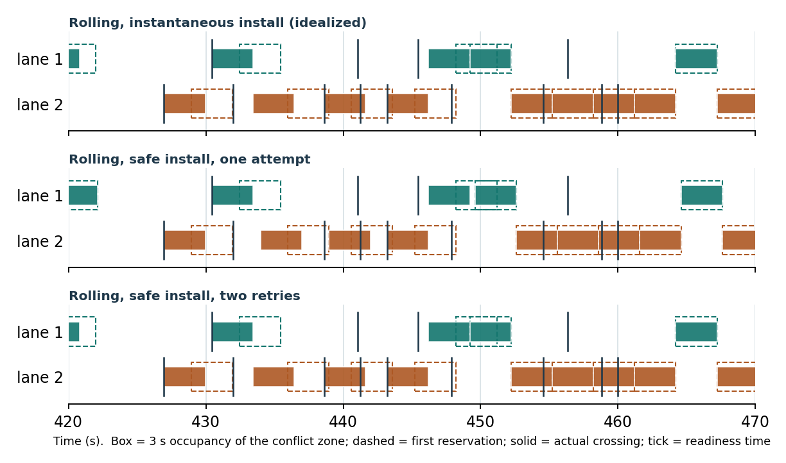
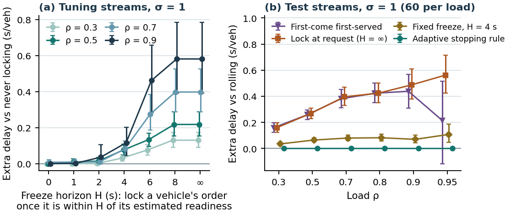
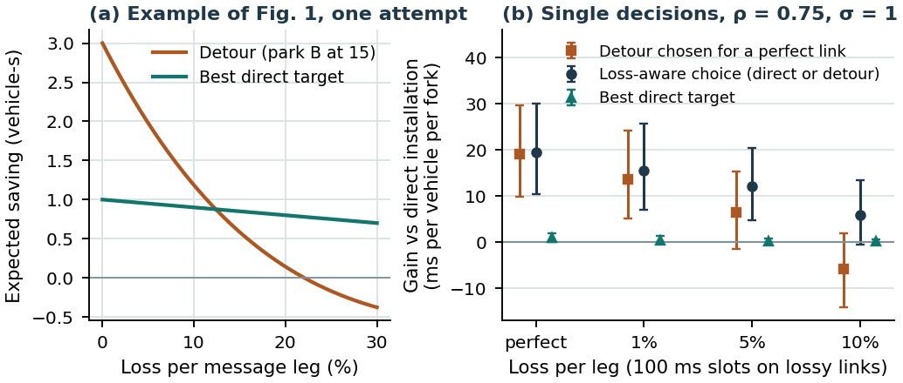
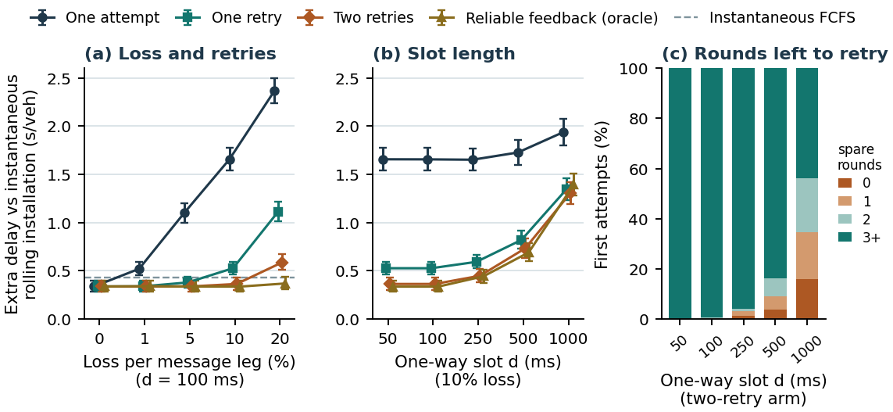
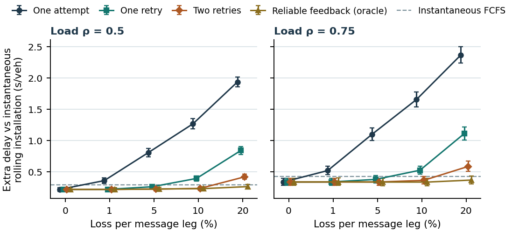
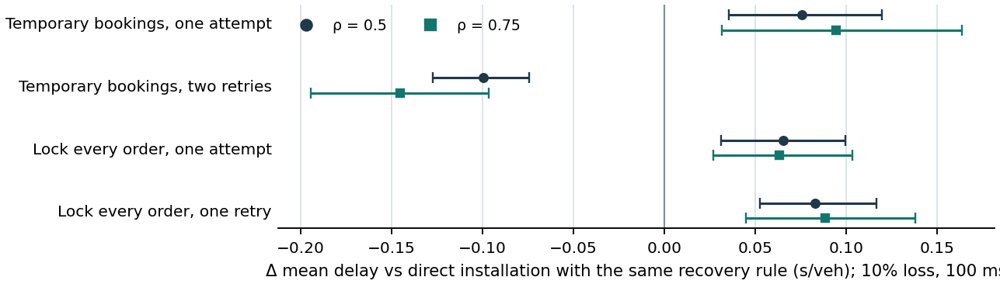

# Which Better Schedule Can the Vehicles Adopt? Safe Revision, Recovery and Commitment at Autonomous Intersections

**CS 329: Foundations of AI: Multiagent Systems** · Indian Institute of Technology Gandhinagar · Final project

**Report:** [`report/CS329_Final_Report.pdf`](report/CS329_Final_Report.pdf) (LaTeX source: [`report/main.tex`](report/main.tex))

| Team member | Roll number |
|---|---|
| Nishchay Bhutoria | 23110222 |
| Tanish Wanve | 23110327 |
| Swayam Borate | 23110066 |
| D A S K R Manognya | 24110097 |

## Overview

Self-driving cars can cross an intersection without traffic lights if a coordinator (the
*intersection manager*) gives each car a reserved entry time and keeps conflicting cars apart. As
cars approach, their predicted arrival times improve, so the manager can keep re-optimizing the
crossing schedule. But a better schedule is useful only if the cars can actually *adopt* it:

* every car already holds a reservation, and a new reservation can be granted only once it no longer
  conflicts with anybody's old one, so some changes (swapping two closely spaced cars) have **no safe
  first step**;
* messages get lost, and when the manager hears nothing back it cannot tell whether the car switched,
  so it must keep **both** reservations blocked;
* a car can only make a change while it is still physically able to.

The project asks: **how can autonomous vehicles safely adopt improved cooperative crossing schedules
when existing reservations, communication uncertainty and physical feasibility constrain plan
changes?** We answer it with a multiagent simulator of a two-lane intersection, exact schedule
optimization, a message-by-message update protocol whose safety does not depend on message
delivery (argument in `docs/methodology.md`, audited in every run), temporary reservations, and
bounded, version-safe retransmission, evaluated in three pre-registered, safety-audited studies.

## Research objectives

1. Formulate safe schedule revision as a multiagent coordination problem (manager and vehicle agents;
   reservations, release dependencies, lossy acknowledgments, physical deadlines).
2. Compare flexible (rolling) and committed (locked) crossing orders.
3. Measure how much of the optimizer's nominal benefit survives safe installation, and why
   (dependency cycles, message loss, deadlines).
4. Design and evaluate the mechanisms that recover it: temporary reservations and retransmission.

## Key results

All numbers are simulation results under the model's assumptions (one conflict zone, synthetic
message erasures, synchronized clocks, cooperative vehicles); the "atomic" and "oracle" arms are
idealized comparators, not deployable protocols. 95% intervals in brackets.

* **Locking orders never helped.** With instantaneous installation, per-cell tuning chose *never
  freeze* in all 24 traffic/noise regimes; first-come first-served cost 0.31 s per vehicle [0.23, 0.39]
  more than rolling optimization. Under lossy installation, locking every order still cost 0.06–0.09 s.
* **Dependency cycles are the structural obstacle.** At 23,472 held-out single decisions, safe
  (release-gated) installation on a perfect link fell short of the ideal atomic update at *exactly*
  the 678 decisions that reversed a tight pair; one temporary reservation repaired 609 of them.
* **Temporary reservations need recovery.** With one transmission per message, the two-vehicle
  example stops paying at about 12% loss per message leg, and on held-out decisions at 10% loss their
  estimated effect was negative in all 12 regimes; with two retries they were the best safe method in
  sustained traffic.
* **Ambiguity, not optimization, dominated the price of safe revision under loss.** At 10% loss per
  message leg, one-attempt safe installation cost 1.66 s per vehicle (ρ = 0.75). One version-safe
  retry recovered 1.13 s [1.02, 1.24] (68%); two retries came within 0.03 s of a loss-free link.
* **Physical deadlines matter only for slow links.** With 100 ms message slots 99% of updates still
  had three or more usable retry rounds; with 1 s slots 16% had none.

## Results (figures generated by the code in this repository)

All images below are produced by `make figures` / `make demo` from the data in `results/data/`.

**Reservation timeline of a simulated stream** (`make demo`): the same held-out traffic under
instantaneous installation, safe installation with one attempt (lost messages leave cars pinned and
delayed), and safe installation with two retries.



**Experiment A: flexible versus locked crossing orders** (report Fig. 2)



**Experiment C: when does a temporary reservation pay?** (report Fig. 3)



**Experiments D and E: loss, retries and physical deadlines** (report Fig. 4)



**Price of safe installation at both loads** and **temporary reservations / locks under recovery** (supplementary)




**Demo output** (`make demo`, actual output):

```text
Demo: one held-out stream (study 5809, rep 0), load 0.75, sigma 1, 10% loss per leg, 100 ms slots
algorithm / installation                     mean delay    p95 pinned  retx unsafe  matches recorded run
--------------------------------------------------------------------------------------------------
Rolling, instantaneous install (idealized)        6.004  17.16     --    --      0  yes
FCFS, instantaneous install (idealized)           6.290  15.87     --    --      0  yes
Rolling, safe install, one attempt                7.260  17.65     28     0      0  yes
Rolling, safe install, one retry                  6.301  15.87      4    32      0  yes
Rolling, safe install, two retries                6.290  15.87      1    36      0  yes
Rolling, reliable feedback (oracle)               6.290  15.87      0     0      0  yes
Rolling + temporary bookings, two retries         6.154  15.74      1    39      0  yes
Lock every order, safe install, one retry         6.314  15.87      4    32      0  yes
```

## Repository structure

```text
FAI_Final/
├── README.md, LICENSE, Makefile, requirements.txt, pyproject.toml
├── src/lockorder/            the simulator and algorithms (Python package)
│   ├── models/               vehicle kinematics (physics.py), information model (belief.py)
│   ├── simulation/           scenario generation with keyed seeds; event-driven engine
│   ├── scheduling/           exact label-setting DP scheduler, brute force, plan validator
│   ├── policies/             rolling, FCFS, freeze-H, adaptive stopping rule (commitment policies)
│   ├── stopping/             finite pair stopping rule used by the adaptive policy
│   ├── replacement/          safe installation: release graph, protocol, temporary reservations
│   │                         (handoff.py), one-attempt closed loop (closed_loop.py), retransmission (retry.py)
│   ├── theory/               quantile-slack helper used by a baseline policy
│   └── evaluation/           policy registry, batch runner, paired bootstrap statistics
├── configs/                  study designs: commitment.toml, sweep.toml, recovery.toml
├── experiments/
│   ├── run_experiments.py    rerun studies (quick or full) and check against recorded data
│   ├── reproduce_report.py   analyses → every report number (report/numbers.tex) and table
│   ├── generate_figures.py   every figure from results/data
│   ├── simulate.py           run one stream with a chosen algorithm / protocol
│   ├── demo.py               quick demonstration
│   └── commitment/, sweep/, recovery/   per-study runner (run.py) and analysis (analyze.py)
├── tests/                    135 unit, property, golden-output and safety tests
├── results/
│   ├── data/                 recorded raw study data (*.csv.gz) and analysis outputs
│   ├── figures/              figures (PDF for the report, PNG for this README)
│   └── screenshots/          demo outputs
├── report/                   main.tex, references.bib, arxiv.sty, numbers.tex, tables/, figures/,
│                             CS329_Final_Report.pdf
└── docs/
    ├── methodology.md            model, algorithms, proofs sketches, experimental design
    ├── report_reproducibility.md every report result → config, data, script, command
    ├── study_designs/            frozen (pre-registered) design records
    └── project_review/           the project-review report this final report completes
```

## Requirements

* Python **3.11 or 3.12** (tested: 3.12.3 on Ubuntu 24.04). The pinned numpy/scipy releases have no
  wheels for Python 3.13.
* Python packages (pinned in `requirements.txt`): numpy 1.26.4, scipy 1.11.4, pandas 2.1.4,
  matplotlib 3.8.4, pytest 9.2.0, hypothesis 6.170.15. Pinning keeps reruns bit-identical.
* `make`. Optional: `pdflatex` and `bibtex` (TeX Live) to rebuild the report.
* Any multi-core CPU; no GPU. The largest process used about 1.8 GB during the full reproduction.

## Installation

```bash
git clone https://github.com/nishchaybhutoria/FAI_Final.git
cd FAI_Final
make setup                    # creates .venv and installs requirements.txt
# or manually:
python3 -m venv .venv && .venv/bin/python -m pip install -r requirements.txt
```

The virtual environment must live on a filesystem that supports symlinks (not exFAT/FAT); if needed,
use `make setup VENV=~/venvs/fai`, and pass the same `VENV=...` to later `make` commands. All
`make` targets use `.venv/bin/python` automatically when it exists.

## Running the project

| Task | Command | Measured time |
|---|---|---|
| Install dependencies | `make setup` | 10 s with a warm pip cache (the first download is about 60 MB) |
| Run the tests (135) | `make test` | 30 s |
| Quick demonstration | `make demo` | 2 s |
| Quick verification: rerun 98 recorded simulation runs and 121 forks exactly, then recheck every report number | `make verify` | 17 s (18 s with `WORKERS=4`) |
| Reproduce the report's numbers, tables and figures from the recorded data | `make reproduce` | 8 s |
| Full reproduction: rerun every study with the original seeds and check bit-identity | `make reproduce-full` | 4 min 23 s with 30 worker processes (6,940 CPU-seconds); *estimated* 30–45 min on 4 cores |
| Regenerate figures only | `make figures` | 2 s |
| Build the PDF report | `make report` | 1 s |

Times were measured in a fresh clone on the development machine (32-thread x86-64, Ubuntu 24.04,
Python 3.12); the 4-core figure is an estimate from the measured CPU time. `WORKERS=n` sets the number
of worker processes (default: all cores but one), e.g. `make reproduce-full WORKERS=8`. Every target
leaves the tracked files unchanged: regenerated analysis tables, figures and the PDF are identical to
the committed ones.

### Run the simulator and select an algorithm

```bash
.venv/bin/python experiments/simulate.py --help
# rolling optimization, idealized instantaneous installation
.venv/bin/python experiments/simulate.py --policy rolling --install atomic
# rolling optimization, safe installation over a 10%-loss link with one retry
.venv/bin/python experiments/simulate.py --policy rolling --install direct --retries 1 --loss 0.1
# temporary reservations with two retries; first-come first-served; a 4 s freeze; the adaptive rule
.venv/bin/python experiments/simulate.py --policy rolling --install detour --retries 2
.venv/bin/python experiments/simulate.py --policy fcfs --install atomic
.venv/bin/python experiments/simulate.py --policy freeze_4 --install direct --retries 1
.venv/bin/python experiments/simulate.py --policy adaptive --install atomic
```

Options: `--policy {rolling,fcfs,freeze_4,freeze_inf,adaptive}`, `--install {atomic,direct,detour}`,
`--retries {0,1,2}`, `--rule {blind,aware,oracle}`, `--loss q`, `--slot d`, `--rho`, `--sigma`, `--rep`.
The scenario is held-out stream `--rep` of the recovery study, so the second command above reproduces
the recorded run `k1`, rep 0 (mean delay 6.301 s).

### Run experiments

```bash
.venv/bin/python experiments/run_experiments.py --mode quick                    # all studies, small subset
.venv/bin/python experiments/run_experiments.py --mode full --study recovery    # one study, full design
.venv/bin/python experiments/reproduce_report.py --data results/rerun --check   # report numbers from the rerun
```

Regenerated data are written to `results/rerun/` (never over the recorded data) and compared
row by row with `results/data/`; any difference aborts with a message.

## Reproducibility

| Study | Report | Config (design, seeds, replications) | Recorded data | Scripts |
|---|---|---|---|---|
| A: commitment (archived E3, study key 329) | §6 Exp. A, Fig. 2 | `configs/commitment.toml` | `results/data/commitment/{tune,test}.csv.gz` | `experiments/commitment/{run,analyze}.py` |
| B, C: single decisions (study 5807) | §6 Exp. B, C, Table 2, Fig. 3 | `configs/sweep.toml` | `results/data/sweep/test.csv.gz` | `experiments/sweep/{run,forks,analyze}.py` |
| D, E: sustained traffic with loss (study 5809) | §6 Exp. D, E, Table 3, Fig. 4 | `configs/recovery.toml` | `results/data/recovery/test.csv.gz` | `experiments/recovery/{run,analyze}.py` |

* **Seeds.** Every random quantity comes from `numpy.random.SeedSequence([study, split, replication,
  stream type, lane or vehicle])` (`src/lockorder/simulation/scenario.py`), so results do not depend
  on the number of workers or the order of execution. Bootstrap seeds are in the config files.
* **Numbers in the report.** Each is a macro in `report/numbers.tex`, generated by
  `experiments/reproduce_report.py`; `make reproduce` fails if any recomputed value differs.
* **Traceability.** [`docs/report_reproducibility.md`](docs/report_reproducibility.md) maps every
  principal result to its config, data file, script and command, with the verification status.
* **Verified.** The full reproduction regenerated all 13,392 sustained-traffic runs and 23,472
  isolated decisions bit-identically, and all 375 report numbers were recomputed exactly from them.

## Team and contributions

Section 7 of the report lists the tasks assigned to each member: Nishchay Bhutoria (research idea,
formulation, algorithm design, methodology, integration), Tanish Wanve (simulation, dynamics,
baselines, validation), Swayam Borate (experiments, benchmarks, statistics, visualization,
reproducibility checks) and D A S K R Manognya (literature, validation documentation, report and
repository documentation). Every member completed all of their assigned tasks.

## Course

CS 329: Foundations of AI: Multiagent Systems, Indian Institute of Technology Gandhinagar.
Code is released under the MIT license.
